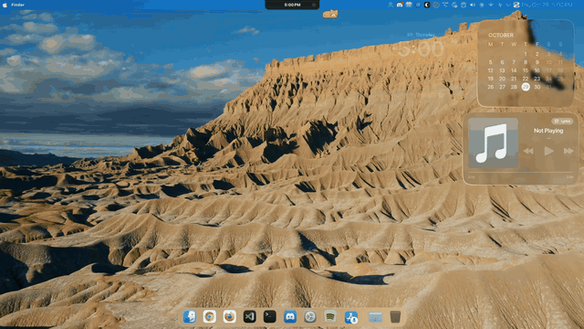
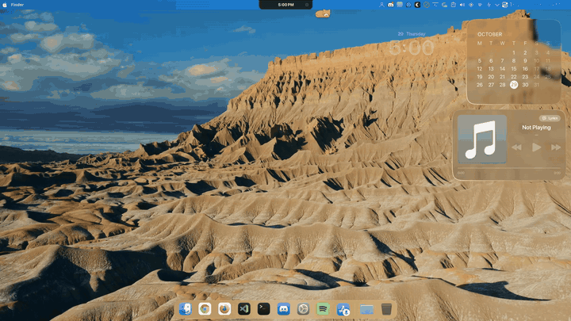
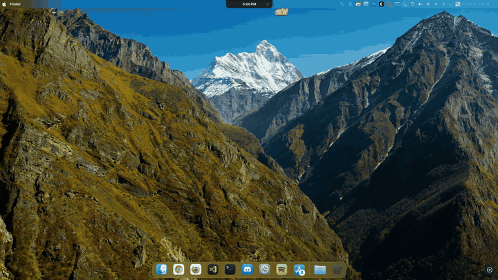
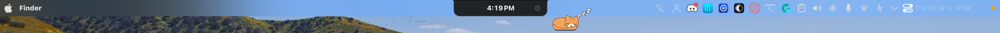
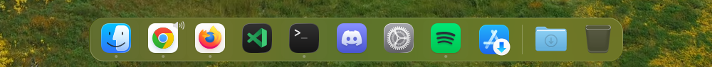
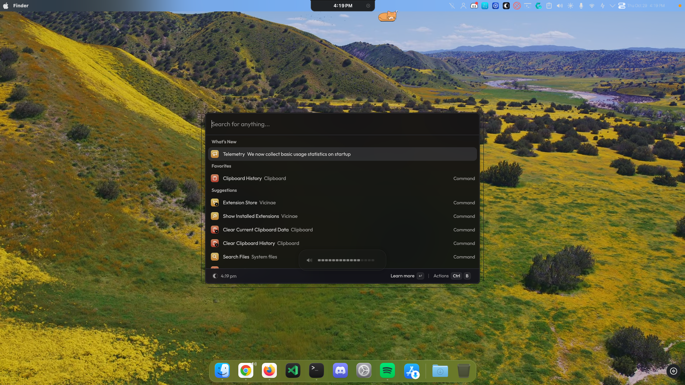
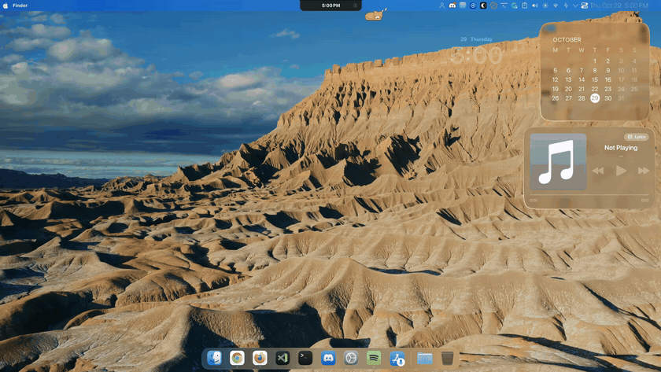

# macOS Tahoe / Sequoia for KDE Plasma 6 Wayland (Arch, CachyOS, Fedora, Ubuntu, openSUSE)

I switched from Windows to CachyOS (Arch Linux) on a dual-monitor setup (`HDMI-A-1` + `eDP-1` on an RTX 4060 laptop) and wanted it to look and behave like macOS Sequoia / Tahoe.

Most Linux-to-macOS guides stop after installing the WhiteSur theme and moving a panel to the bottom. As soon as you actually use the machine for work, plugging in a second monitor, maximizing windows, sharing your screen on Google Meet, locking the screen, or using Spotlight on Wayland, things start breaking.

This repo contains the actual scripts, QML overrides, KWin rules, custom Plasma 6 applets, and binary patches we wrote to fix those gaps.

### Full Showcase (Edited in [Concat](https://github.com/jub0t/Concat) via MCP — [`assets/showcase.mp4`](assets/showcase.mp4))







---

## Visual Tour & What's Inside

### 1. Top Menu Bar, Dynamic Island & Privacy Dots (`bin/macos-multiscreen-sync.sh`)



- **Per-Monitor App Title & Global Menu:** Each monitor's top bar (`28px`, translucent with KWin `better_blur_dx` dock blur) filters `org.kde.windowtitle` and `org.kde.plasma.appmenu` to that screen only, showing `Finder` when the desktop is focused.
- **Dynamic Island (`org.phobby.dynamicisland`):** Centered notch with media controls, Google Calendar `.ics` events, weather, and a sleeping cat.
- **macOS Privacy Dots (`plasmoids/org.macos.privacydots`):** Notice the small **orange dot (`#FF9500`)** at the far top-right of the menu bar in the screenshot above. It polls PipeWire (`pw-dump`) and `/dev/video*` every 2 seconds:
  - **Orange dot (`#FF9500`):** Microphone in use
  - **Green dot (`#34C759`):** Camera in use
  - **Purple dot (`#5856D6`):** Screen sharing / recording active
  - Stays `0px` wide when nothing is capturing. Click the dots to see the exact process names recording your mic, camera, or screen.

---

### 2. Bottom Floating Dock & The 0.82x Icon Sizing Fix (`plasmoids/org.macos.*`)



Plasma 6 has two annoying quirks with floating docks:
1. Adding the built-in `org.kde.plasma.marginsseparator` changes `inSlimMarginsArea` inside Plasma's `PanelLayout`, shrinking every icon to the right of the divider.
2. Custom QML applets default to a smaller `AppletContainer` allocation unless they explicitly declare `Plasmoid.constraintHints: Plasmoid.CanFillArea`.

We replaced the stock widgets with three custom Plasma 6 applets (`org.macos.dockseparator`, `org.macos.downloads`, `org.macos.trash`) and patched `AndromedaLauncher` so every icon in the dock renders at a uniform `0.82x` panel height. The dock uses `dodgewindows` (`panelVisibility=2`, `unhideOnAttention=false`) so it slides out of the way whenever a window maximizes.

---

### 3. Spotlight (`Vicinae`) & 16-Chiclet OSD Pill on Wayland



- **Replacing KRunner with Vicinae (`bin/krunner-dbus-bridge.py`):** On KDE Plasma 6 Wayland, `kwin_wayland` intercepts `Meta+Space` and `Alt+Space` at the compositor level and invokes `org.kde.krunner` over D-Bus. Disabling KRunner isn't enough, we run a lightweight Python D-Bus bridge that claims the `org.kde.krunner` bus name and routes `display()` (`Win+Space` / `Alt+Space`) to `vicinae toggle` and `displayWithClipboardContents()` (`Win+V`) to `vicinae cmd launch clipboard:history`.
- **16-Chiclet Volume & Brightness OSD (`shell-overrides/osd/`):** Replaces KDE's stock progress-bar popup with a compact `230x44` frosted pill featuring 16 segmented white chiclets (visible right below the Spotlight window in the screenshot above).

---

### 4. macOS Sequoia / Tahoe Lock Screen & SDDM Login (`shell-overrides/lockscreen/`, `sddm/`)



- **Top Clock & Date:** `SF Pro Display` (`22px DemiBold` date stacked tight above `112px Bold` time at `9.5%` from top) with soft drop shadows.
- **Bottom Avatar & Frosted Password Pill:** `56x56` circular avatar, user full name, `196x30` translucent pill (`Enter Password` placeholder, circular `→` submit button that fades in when typing), and `"Touch ID or Enter Password"` caption.
- **Zero-Black-Screen Aerial Playback:** `kscreenlocker_greet` runs inside a network sandbox (`NoAccessNetworkAccessManager`), which stalls network-based wallpaper plugins. Our lock screen renders the 4K `MacTahoe` fallback image at `t=0ms` and immediately loops cached Apple TV Aerial `.mov` clips from `~/.cache/aerial-wallpaper/videos/`.

---

### 5. Apple TV Aerial Video Wallpapers (`patches/patch-aerial-core.py`)

The `io.github.birkneralex.aerial` plugin throttles video downloads to 1 video per 24 hours (`download_interval_secs = 86400`), and attempting to bind `downloadIntervalSecs: 0` in QML crashes on Qt 6 because CXX-Qt registers `qint64` (`qlonglong`) without implicit JS `int` conversion (`Cannot assign value 0 to property downloadIntervalSecs`).

`patches/patch-aerial-core.py` patches the compiled Rust constructor (`AerialCacheRust::default`) inside `/usr/lib/libaerial_core.so` (`movq $0x15180, 0x28(%rsp)` -> `0x0`) so all Aerial flyovers download and shuffle out of the box. We also default multi-monitor setups to `SDR1080` instead of `HDR4K` so two screens don't eat 4.4 GB of NVIDIA VRAM.

---

### 6. Screen-Sharing & Network Privacy (`bin/macos-screenshare-privacy.py`)

- **Auto "Do Not Disturb" on Screen Share:** Watches PipeWire (`pw-dump`). The second a screen-share stream (`kwin` / `xdpw` / `portal`) starts, it acquires an `org.freedesktop.Notifications.Inhibit` lock so private message popups never appear on stream, releasing it as soon as sharing stops.
- **Auto "Presentation Mode" (Hide Desktop Icons):** Automatically switches the Desktop FolderView URL to an empty directory while screen sharing is active so your `~/Desktop` files stay hidden without losing their saved grid coordinates.
- **WhatsApp Web Privacy Blur (`chrome-ext/` + CDP auto-reinject):** Blurs chat sidebar rows, messages, and contact headers until hovered. Press **`Alt+X`** inside WhatsApp Web to toggle the blur on/off.
- **Google Meet Floating Overlay Fix (`kwin/chrome-pip-top/`):** On Wayland, Chrome cannot set `keepAbove` on Document Picture-in-Picture windows, and titles them `Meet - <Meeting Name>` without the ` - Google Chrome` suffix. Our event-driven KWin script keeps only the compact PiP overlay on top while leaving main Chrome windows normal.
- **Private Wi-Fi MAC & Encrypted DNS (`etc/`):** Enables per-SSID stable MAC randomization (`wifi.cloned-mac-address=stable`), IPv6 privacy extensions (`ip6-privacy=2`), and `DNSOverTLS=opportunistic` via Cloudflare (`1.1.1.1#cloudflare-dns.com`).

---

## Quick Start

```bash
git clone https://github.com/TejasLamba2006/macos-tahoe-arch.git
cd macos-tahoe-arch
cp .env.example ~/.config/macos-tahoe.env   # optional: add your GOOGLE_ICAL_URL
./install.sh
```

See the step-by-step deep dives in [`docs/`](docs/):
- [`docs/01-panels-and-dock.md`](docs/01-panels-and-dock.md) -- Multi-monitor sync, dodge-windows, and the 0.82x dock icon fix
- [`docs/02-aerial-and-lock.md`](docs/02-aerial-and-lock.md) -- Aerial `libaerial_core.so` binary patch, VRAM tuning, and Lock Screen QML
- [`docs/03-spotlight-and-wm.md`](docs/03-spotlight-and-wm.md) -- KRunner-to-Vicinae Wayland D-Bus bridge & Chrome Document PiP KWin script
- [`docs/04-privacy-and-share.md`](docs/04-privacy-and-share.md) -- Menu bar privacy dots, screen-share Auto-DND / Presentation Mode, and WhatsApp blur
- [`docs/ROADMAP.md`](docs/ROADMAP.md) -- What's left to build & how to request the next macOS feature

---

## Want Something Ported Next?

If there is a macOS feature, gesture, animation, or workflow you want replicated on KDE Plasma 6 Wayland (Arch, Fedora, Ubuntu/Kubuntu, openSUSE, NixOS), **[open a Feature Request issue](../../issues/new?template=feature-request.yml)** or check [`docs/ROADMAP.md`](docs/ROADMAP.md).

## Credits

Built on top of KDE Plasma 6, [WhiteSur / MacTahoe themes](https://github.com/vinceliuice/MacTahoe-gtk-theme) by Vince Liuice, [Vicinae](https://github.com/vicinaehq/vicinae), [Dynamic Island](https://github.com/phobby/dynamicisland), [macOS Liquid Glass Widgets](https://github.com/jaxparrow07), [KWin Better Blur DX](https://github.com/taj-ny/kwin-effects-forceblur), and [plasma6-wallpapers-aerial](https://github.com/birkneralex/plasma6-wallpapers-aerial).
