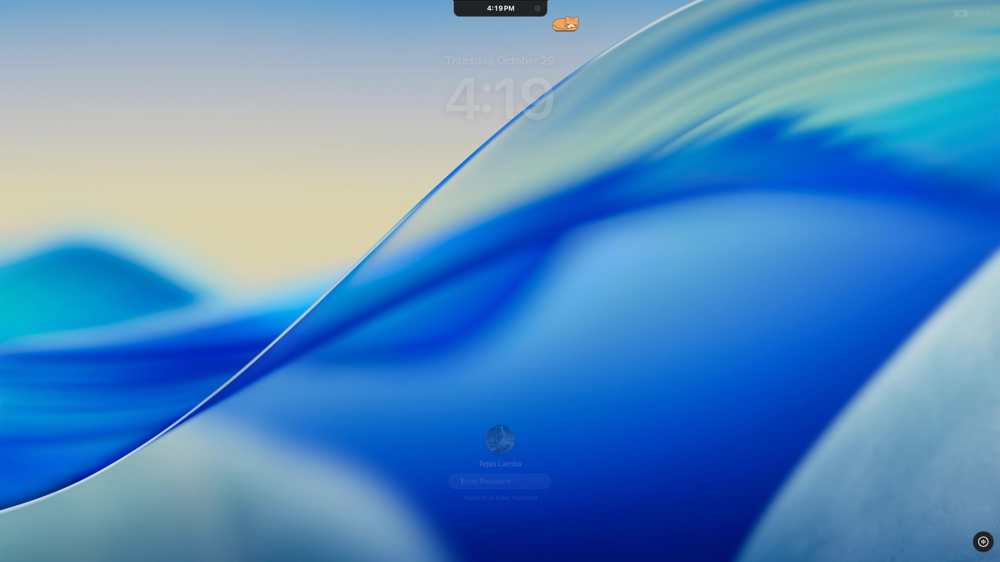

# 02. Apple TV Aerial Wallpapers & macOS Tahoe Lock Screen



## 1. Bypassing the 24-Hour Download Limit in `plasma6-wallpapers-aerial`

`io.github.birkneralex.aerial` is a Rust + CXX-Qt plugin (`/usr/lib/libaerial_core.so`). Out of the box, it limits video downloads to **1 clip per 24 hours** (`download_interval_secs: 86400`), meaning your wallpaper loops on a single video all day.

If you try to override `downloadIntervalSecs: 0` inside `contents/ui/main.qml`:
```
Cannot assign value 0 to property downloadIntervalSecs
```
CXX-Qt registers `download_interval_secs` as a 64-bit `qlonglong`, and Qt 6 QML rejects binding a JS `int` literal to `qlonglong` in object initialization, causing `plasmashell` to abort loading the wallpaper completely on boot.

### The Binary Patch (`patches/patch-aerial-core.py`)
Instead of fighting CXX-Qt's QML type converter, we patch the immediate constant inside `AerialCacheRust::default` in `/usr/lib/libaerial_core.so`:
```
1d5cf4: 48 c7 44 24 28 80 51 01 00    movq $0x15180, 0x28(%rsp)   # 86400 seconds
      -> 48 c7 44 24 28 00 00 00 00    movq $0x0,     0x28(%rsp)   # 0 seconds
```
We also patched `patches/aerial-main.qml` so that on boot (`root.loading === true`), if the first shuffled video is still downloading, it plays an already-cached `.mov` from `~/.cache/aerial-wallpaper/videos/` immediately instead of showing a black rectangle.

## 2. Fixing the 4K 10-Bit HEVC VRAM Exhaustion on Dual Monitors

Each Apple TV Aerial 4K HDR (`yuv420p10le` Dolby Vision HEVC) decoder instance uses ~1.1 GB of VRAM in `plasmashell` (ping-pong `playerA` + `playerB` across 2 screens = 4 decoders = **4.4 GB VRAM**). On an 8 GB GPU running CUDA workloads (like Whisper), locking the screen spawns `kscreenlocker_greet`, which hits `CUDA_ERROR_OUT_OF_MEMORY` in `cuvidCreateDecoder`.

Switching the desktop plugin to `SDR1080` on 1080p monitors drops `plasmashell` VRAM usage by over 3 GB while keeping 60fps hardware decoding.

## 3. macOS Sequoia / Tahoe Lock Screen (`shell-overrides/lockscreen/`)

### Important KPackage Gotcha
If you create `~/.local/share/plasma/shells/org.kde.plasma.desktop/contents/lockscreen/` to override the lock screen, **you must symlink the rest of `contents/*`** (`views`, `applet`, `configuration`, `activitymanager`, `explorer`, `main.js`, etc.) from `/usr/share/plasma/shells/org.kde.plasma.desktop/contents/`. Otherwise `KPackage` treats your local folder as the entire shell, fails to find `views/Desktop.qml`, and crashes `plasmashell` (`Empty file name passed to ContainmentView`). `install.sh` sets up these symlinks automatically.
